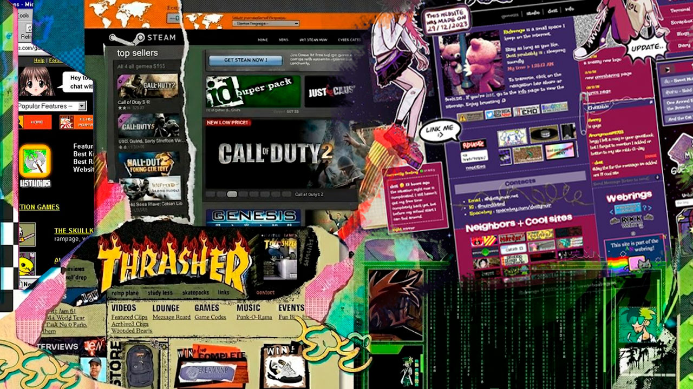
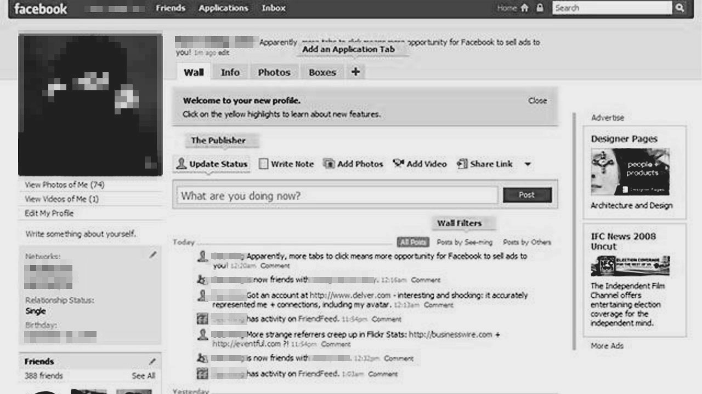

**So, why start writing a blog in 2026?**

I’m going to be honest, as I’m writing this post, I don’t have the answer, but I can assure you, that if you’re reading this, I probably figured it out along the way, so I invite you to this short journey of discovery.

Let’s start with a better question, a simple one.

**Why were blogs a thing back then?**

Well, without much research we can guess it was the only way to express so much of ourselves on the internet back then, we didn’t have social media as YouTube, TikTok, Instagram, etc. People didn’t have to think about it so much, it was actually the only way to be more than online, people wanted to be part of the internet.

As time went by, we got better things to do, I guess, you don’t have to set up an entire website to be online, now you can just post on Facebook or Instagram and share right there very easily, it’s actually much less time-consuming - if you don’t think about the time you spend consuming other people’s content.

**But hey, does it mean blogs are dead?**

Not really, but now, Google’s algorithms are better at finding more accurate blog content, or it was supposed to be… So now we have this thing called SEO, that is “Search Engine Optimization”, so now we are thrown into a race to be the most optimized website/blog that we can, or be dead at the bottom of the Goooooooooooooooooooooo - you’re here - ogle search page, and that sucks, but also don’t.

You see, there’s some value on posting blogs nowadays, and I think it’s not just nostalgia, hear me out, you probably already heard about TikTok, it’s fun, it’s fast, but people are still creating YouTube channels to make a living, for the vibes, or even to have a place to share their knowledge, and yeah, I know you can do it on TikTok too, but I think people are different, and they want different things.

Maybe you want things to be slow, maybe you just want to write something, not record a video, maybe you’re not very skilled with a camera, or you just can’t buy one right now.

That’s probably why I’m here, I really want to make video content about my projects, but working on other purpose$, I have almost no time to record a video, does it mean I’ll not make a YouTube channel? No, but at least I can write my ideas and publish them somewhere, so it won’t become one more lost idea in the drawer.

I also want to share my knowledge, and bring some attention to my thoughts and my [Portfolio](http://thneppel.com.br/), at the end of the day, it’s not that complicated why start a blog in 2026, the real question is:

**Why not start a blog in 2026?**

I know we have AIs to answer our questions, but most of them will search online for those answers, and guess what? They get them from blogs too, and that’s a good thing because we want our content to be relevant enough to be recommended by an AI agent, I know it’s a lot about SEO, but also about knowledge and experiences.

Writing good content and having a little knowledge about how to write, will bring you some relevance on search engines, not just that, but people who find you will see that you know what you’re talking about, that’s why I choose to implement a blog on my portfolio, to raise the value of my experiences better than just looks.

I wanted a place to dump my ideas and thoughts, and choosing to write in English is also a strategic way to reach more people and get better at writing in English as a non-native English speaker.

So in conclusion, it’s a very niche thing to have a blog nowadays, but if you have a website for work, fun and vibes, or any other purposes, and you want to bring relevance to it, creating a blog is the best strategy, but I think we can appreciate more the arts and crafts of building a blog, the writing, the storytelling, the journalism, the freedom to be more than an algorithm feeder, it’s a hobby too.

**So, why don’t you start a blog in 2026?**
