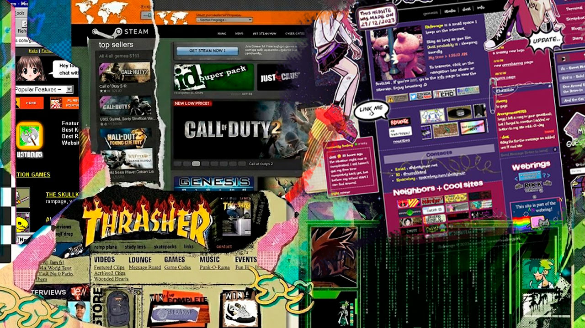
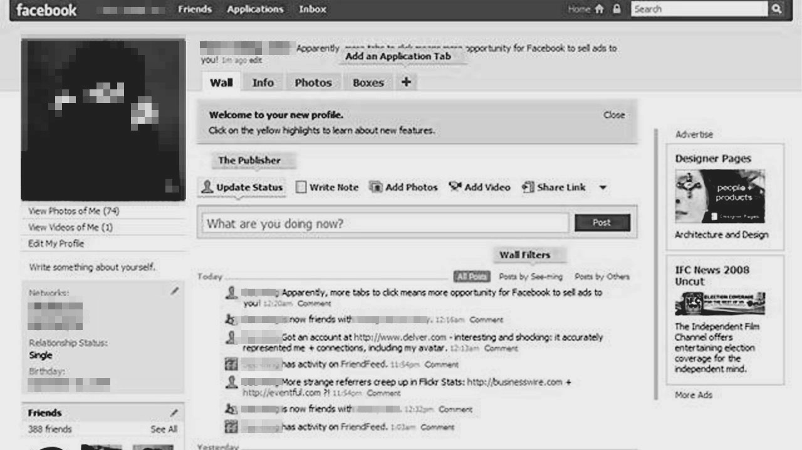

**Por que começar a escrever em um blog em pleno 2026?**

Sendo bem sincero, enquanto escrevo este texto, eu não tenho essa resposta pronta. Mas se você está lendo isso, é sinal de que fui descobrindo o motivo pelo caminho, então te convido para essa pequena reflexão.

Vamos começar por uma pergunta mais simples.

**Por que os blogs eram tão fortes antigamente?**

Sem precisar pesquisar muito, dá para notar que era uma das poucas formas de se expressar com profundidade na internet. Não existiam plataformas como YouTube, TikTok ou Instagram com o peso de hoje. As pessoas não precisavam pensar muito: ter um blog era a forma de fazer parte da web e ir além de apenas navegar.

Com o tempo, encontramos outras formas de ocupar o tempo. Hoje ninguém precisa montar um site inteiro para estar online: basta publicar no feed ou nos stories de forma rápida. Dá muito menos trabalho, desde que você desconsidere as horas que gasta consumindo o conteúdo dos outros.

**Isso significa que os blogs morreram?**

Não exatamente. Os mecanismos de busca ficaram mais precisos e passamos a lidar com SEO (otimização para motores de busca). Isso virou uma corrida constante para ver quem tem o site mais otimizado ou quem vai parar no fundo das páginas do Google, o que tem seus lados bons e ruins.

Ainda vejo muito valor em publicar em blogs. Não acho que seja mera nostalgia. O TikTok é rápido e dinâmico, mas as pessoas continuam criando canais no YouTube para viver disso, pelas conversas ou para compartilhar conhecimento. Cada formato atende a uma necessidade diferente.

Às vezes você quer um ritmo mais calmo. Quer apenas sentar e escrever, sem ter que ligar uma câmera, ajustar iluminação ou gravar áudio.

É exatamente por isso que estou aqui. Quero produzir conteúdo em vídeo sobre meus projetos, mas entre demandas de trabalho, muitas vezes não sobra tempo hábil para gravar e editar um vídeo inteiro. Isso significa que desisti do YouTube? De forma alguma. Mas escrever me permite registrar ideias e publicá-las em algum lugar, em vez de deixá-las esquecidas em uma gaveta.

Também quero compartilhar o que aprendi e direcionar olhares para os meus pensamentos e para o meu [Portfólio](http://thneppel.com.br/), afinal a pergunta não é tão complicada assim. A pergunta de verdade é:

**Por que não começar um blog em 2026?**

Hoje temos ferramentas de IA que respondem quase tudo. Mas de onde a maioria delas puxa as referências? De blogs e sites independentes. Ter conteúdo relevante ajuda a ser referenciado, além de registrar conhecimento prático e vivências reais.

Escrever com clareza traz relevância nas buscas e mostra para quem chega até aqui que você entende do que fala. Foi por isso que decidi incluir o blog junto ao portfólio, dando contexto às minhas experiências para além da estética visual.

Eu queria um espaço para organizar ideias e reflexões. Escrever em inglês também é uma escolha intencional para alcançar mais pessoas e praticar a língua. Mas poder ler e navegar em português mantém o espaço próximo e acessível.

Ter um blog hoje pode parecer algo fora da curva, mas se você tem um site para trabalho ou projetos pessoais e quer construir relevância de longo prazo, escrever ainda é uma estratégia sólida. Além disso, existe o gosto pelo processo: escrever, contar histórias e ter a liberdade de criar algo fora do ritmo dos algoritmos.

**E você, por que não começa um blog também?**
