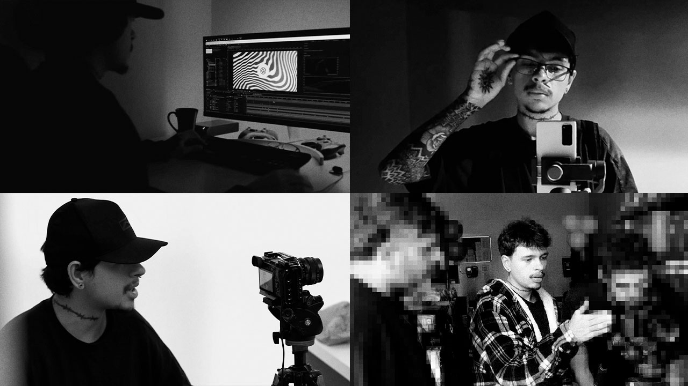
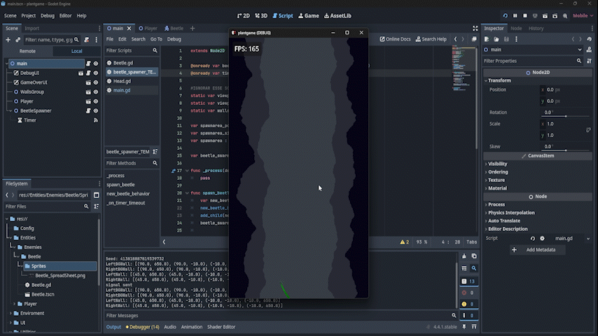

I probably shouldn’t start my first post here with such depressing thought, but hey, I wouldn’t be writing on a blog in 2026 if I wasn’t inspired to create and share good things in the future, so I think it’s normal and even necessary that we talk about the hard things, and maybe, my story here starts with an end. A conflicted one.

Well, I’m tired of what I’ve been doing in the past years, working on projects that aren’t mine, being hired to sell a lot of bullshit. For those who don’t actually know me, I work with marketing, I started in graphic design and then switched to video production.

And God… I hate marketing, but guess what? I’m good at it.

So for the last five years - or more - I’ve been planning how to use my abilities for my own good, and for the ones that I care about. Unfortunately this path is actually very hard to follow, mostly because you probably don’t want to starve, and take cold showers or get evicted.

That’s why I’ve been chasing the ‘digital freelancer’ lifestyle more, so I can have more free time to plan and execute my projects, while receiving some income. Apparently, that is very time-consuming too, but at least I can arrange some time for myself.

So, what is the problem you ask? The market is collapsing, with the hordes and hordes of graphic designers, video editors, marketers, plus the AIs, it all turns against my ‘freelancer’ way out plan.

Now, in may 2026, I was fired from my remote job that I was trying to quit already, so I can pursue what really makes sense for me, with the belief that soon I’ll be wealthy and independent with my own projects.

I always thought that I was a very skilled individual… But somehow, I didn’t make so much for myself and my dreams, but for those who paid me barely enough.

Now, I’m thrilled to start my new journey, and scared too… But it will work out.

I want to focus more on freelance projects and produce content for YouTube, TikTok and Blog while I work on my project called [Matka Studios](http://matkastudios.com), that is my game studio, yes, I want to make videogames too, that’s my childhood dream, and now, I can see it coming true.

Maybe this is just a letter, to my future self, and if you’re in a similar place you probably can relate to it too, so go make something that you love, even if you have to start slowly, start as soon as possible, I’m now 26 years old turning 27 this year, time has passed, but I still think about the things I wish I had done earlier, and I’m not waiting until my 60s so I can be more assured that I regret the things I didn’t do.
