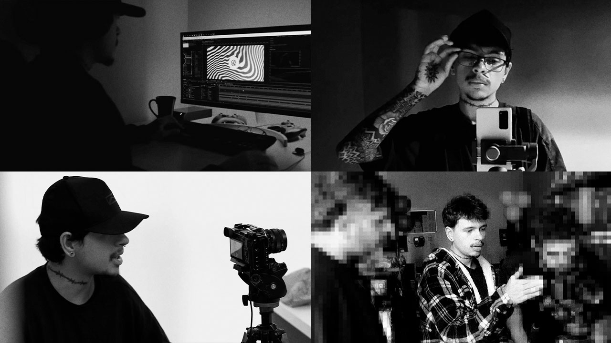
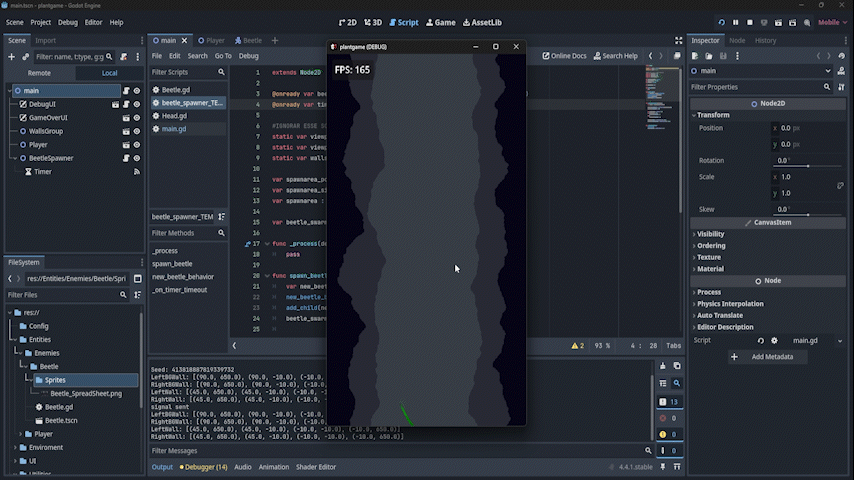

Talvez eu não devesse começar meu primeiro post com um pensamento tão pesado, mas a verdade é que eu não estaria escrevendo em um blog em 2026 se não estivesse inspirado a criar e compartilhar coisas boas. Então acho normal e até necessário falar sobre as partes difíceis, e talvez minha história aqui comece justamente com um fim. Um fim cheio de conflitos.

O ponto é que cansei do que vinha fazendo nos últimos anos: trabalhar em projetos que não são meus, contratado para vender um monte de bobagens. Para quem não me conhece, trabalho com marketing. Comecei no design gráfico e depois migrei para a produção de vídeo.

E olha... eu odeio marketing, mas adivinha só: sou bom nisso.

Nos últimos cinco anos (ou mais), passei muito tempo planejando como usar minhas habilidades para mim mesmo e para as pessoas com quem me importo. Só que esse caminho é bem difícil de trilhar, principalmente porque ninguém quer passar aperto, tomar banho frio ou ser despejado.

Por isso comecei a buscar mais a rotina de freelancer remoto, para ter mais tempo livre para planejar e tocar meus próprios projetos enquanto garanto alguma renda. Na prática, isso consome bastante tempo também, mas pelo menos consigo reservar alguns momentos para mim.

E qual é o problema? O mercado está saturado. Entre enxurradas de designers, editores, profissionais de marketing e a chegada das IAs, tudo parece remar contra o plano de saída pelo caminho freelancer.

Agora, em maio de 2026, fui demitido do trabalho remoto do qual eu já vinha querendo sair. Foi o empurrão para buscar o que realmente faz sentido para mim, com a certeza de que logo estarei independente financeiramente com meus próprios projetos.

Sempre me considerei alguém capaz e habilidoso. Mas, por algum motivo, produzi pouco para mim mesmo e para os meus sonhos, dedicando a maior parte da energia a quem mal me pagava o suficiente.

Estou animado para começar essa nova fase, e com medo também. Mas vai dar certo.

Quero focar em projetos como freelancer e produzir conteúdo para YouTube, TikTok e Blog enquanto toco a [Matka Studios](http://matkastudios.com), meu estúdio de jogos. Sim, também quero criar videogames. É meu sonho de infância e agora consigo vê-lo tomando forma.

Talvez isso seja só uma carta para o meu eu do futuro. Se você estiver passando por algo parecido, provavelmente vai se identificar. Então vá criar algo que você ame, mesmo que precise começar devagar, mas comece o quanto antes. Tenho 26 anos agora, fazendo 27 este ano. O tempo passou, e ainda penso nas coisas que gostaria de ter feito antes. Não vou esperar chegar aos 60 para ter certeza de que me arrependo do que deixei de fazer.
