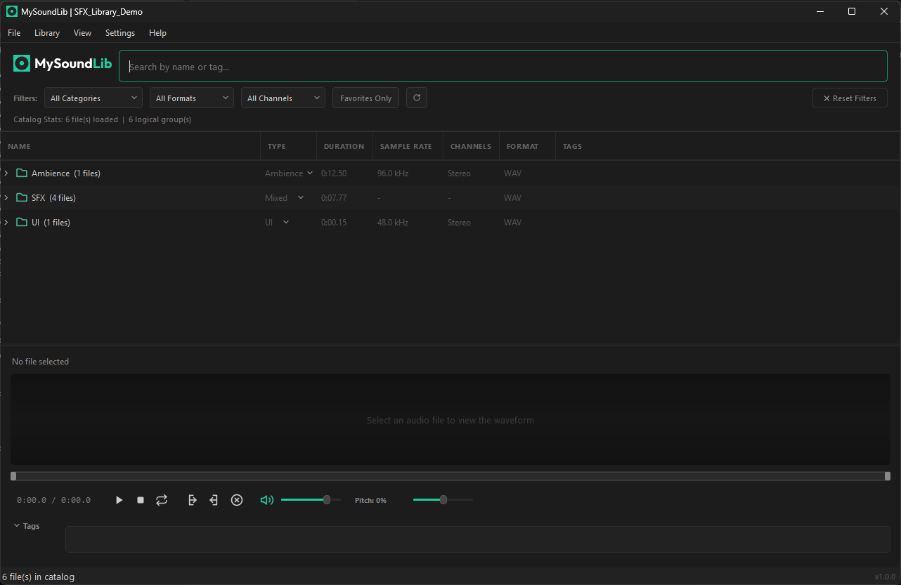
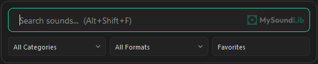
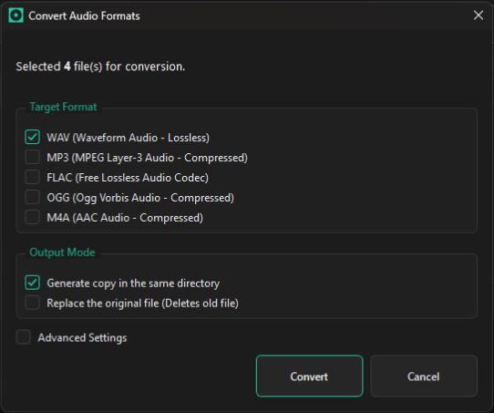

Every time you leave Premiere, DaVinci, or CapCut to hunt down an audio file in your system folders, your editing momentum dies.

You are locked in the zone, nailing cuts down to the exact millisecond, and you need a crisp mechanical impact. Instead of solving that in three seconds, you minimize your editor. You dig through a SFX pack you downloaded. You preview five files in a slow media player. You drag a three-minute track into your timeline just to grab a half-second transient, leaving your project bin littered with junk.

Repeat that across forty cuts a day, and you just burned nearly an hour of pure creative time without putting a single useful frame on screen.

I dealt with that friction for years while editing in Premiere Pro and After Effects. The market offered two terrible options: bloated enterprise tools built for Hollywood post-production houses, or modern utilities that charge an ongoing monthly subscription just to search files already sitting on your own internal SSD.

Both options were unacceptable to me. So I built [MySoundLib](https://mysoundlib.com/): a fast, local desktop app designed for one job. You hit a shortcut over your editor, grab the exact slice of sound you need, and drop it straight onto your timeline track.

## 1. Instant Search Floating Over Your Timeline

The biggest productivity killer in video editing is window switching. Every time you Alt+Tab to search for audio in Finder or Windows Explorer, your brain loses its grip on the rhythm of the cut.

In MySoundLib, file explorers become obsolete.

You press a global hotkey, **Alt + Shift + F** on Windows and Linux or **Cmd + Shift + F** on macOS. A search bar pops up immediately over your video editor without minimizing your project window.

You type *"sub hit"*, press the spacebar, and hear the preview in your headphones in milliseconds. The search engine scans gigabytes of audio instantly, letting you filter by format, channels, or custom tags. Found the sound? You drag it straight onto the audio track and keep cutting. No split screens, no clutter, no lost focus.

## 2. Surgical Waveform Trimming Before You Clutter Your Project

One of the worst habits in timeline assembly is importing full files when you only need a fraction of a second. Sound designers love packing twenty risers or thirty impacts into a single long audio file.

When you drag that raw file into your project:
- Your project file balloons in size.
- Autosaves start hanging your machine.
- You waste time zooming in, razor-blading the edges, deleting empty tails, and dragging manual fades.

In MySoundLib, you see the complete waveform the moment you hit play. Using your mouse, you drag across only the transient peak or the reverb tail you want, and drag exclusively that selected slice directly into your timeline.

The trim is completely non-destructive. The original audio file on your disk remains intact, but your NLE receives a lightweight, clean snippet. You can even adjust the pitch or playback speed right inside the interface before dropping the clip onto your track.

## 3. Built-in .opus Conversion Without Shady Web Tools

Anyone editing for content creators or client accounts knows this specific headache: the client sends a voice note, interview clip, or reference audio over WhatsApp, and the file arrives in `.opus` format.

You drag it into Premiere Pro or DaVinci Resolve, and the software immediately rejects it with an import error. The traditional workaround is annoying: open a web browser, search for sketchy online converters full of pop-up ads, upload your client's confidential voice note to an unknown server, and wait to download a converted file.

MySoundLib eliminates that detour with an integrated local conversion engine.

It reads OPUS, FLAC, OGG, M4A, AIFF, MP3, and WAV natively. When you run into a format your video editor refuses to open, you convert it directly inside the app to high-fidelity WAV or MP3 in seconds, individually or in batch. You drag the resulting clip straight onto your tracks with zero internet reliance, zero third-party sites, and zero data leaks.

## 4. Visual Waveform Auditioning for Music Tracks and Pacing

Searching for sound effects relies on concrete nouns like footsteps, clicks, and punches. Choosing music tracks depends entirely on energy, dynamics, and instrumentation.

The problem with keeping music in generic folders is that filenames like `Corporate_Inspiring_v3_120bpm.mp3` tell you nothing about how the track unfolds. You are forced to listen from second zero just to find where the beat actually kicks in.

With dedicated libraries inside MySoundLib, you can categorize music by client, project, or vibe. More importantly, you read the waveform visually in seconds. You can instantly see where the drop happens, where the instrumentation empties out, and where the chorus hits, letting you find the right pacing without loading heavy players or caching unwanted audio into your editor.

## 5. Truly Local Software: Zero Cloud, Zero Monthly Subscriptions

The software market has developed an obsession with recurring subscription fees for tools that only interact with local files. Paying ten or twenty dollars every month just to search files on your own hard drive makes no sense.

MySoundLib is built on a straightforward principle: it is your computer, they are your files, and the software should belong to you.

- **100% Offline**: Nothing uploads to a cloud server, there is no invasive tracking, and the app never stops working if your internet drops during a deadline crunch.
- **Universal NLE Compatibility**: Runs across Windows, macOS, and Linux, and supports any software that accepts dragged files, including Premiere Pro, DaVinci Resolve, CapCut Desktop, After Effects, Final Cut Pro, Vegas Pro, and Reaper.
- **$19 Lifetime License**: A single, one-time payment. You buy a license for your personal use, install it on your primary editing rig and your laptop, and own it with all updates included.

---

If your current audio workflow consists of wading through nested folders and trimming three-minute files inside your project bin, stop wasting time as a file archivist.

Check out the app at [mysoundlib.com](https://mysoundlib.com/) and get back to what actually matters: the rhythm of your cut.
