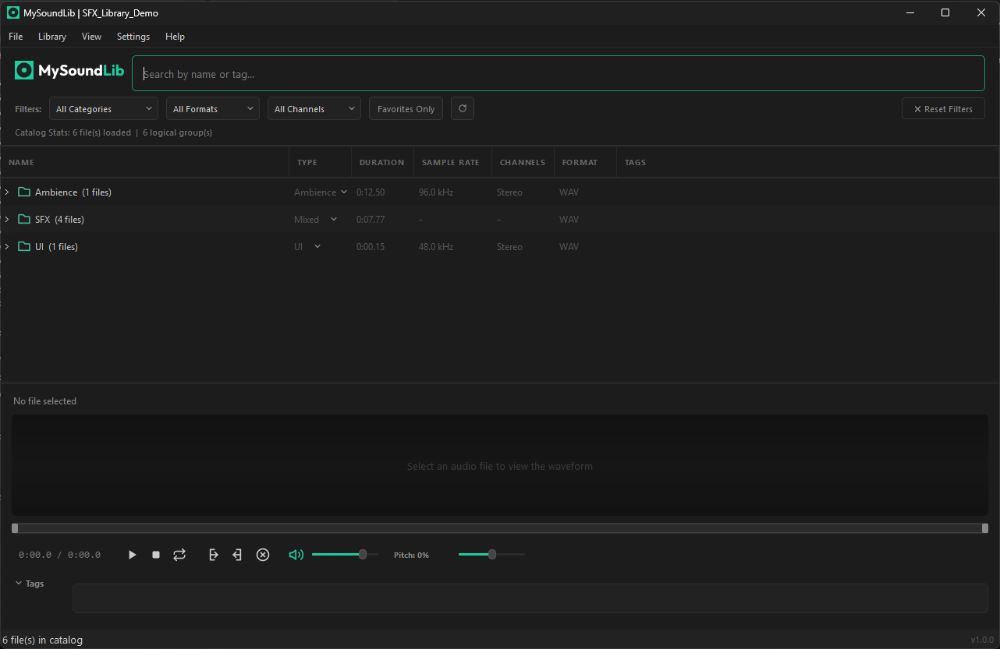
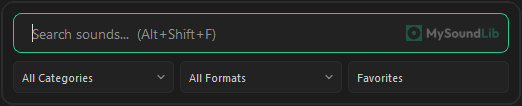
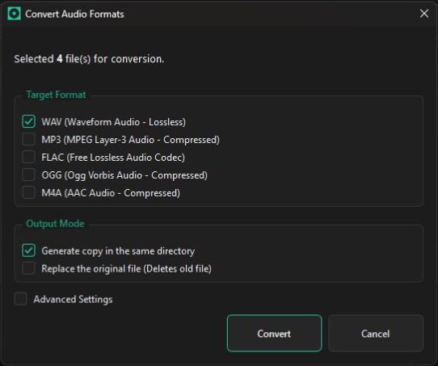

Toda vez que você sai do Premiere, DaVinci ou CapCut para caçar um arquivo de áudio nas pastas do sistema, o ritmo da sua edição morre.

Você está totalmente focado, cravando cortes no milissegundo exato, e precisa de um impacto mecânico seco. Em vez de resolver isso em três segundos, você minimiza o editor. Vasculha um pack baixado de SFX. Ouve cinco arquivos num player de mídia lento. Arrasta uma faixa de três minutos para a sua timeline só para pegar meio segundo de transiente, deixando os bins do seu projeto entulhados de lixo.

Repita isso ao longo de quarenta cortes por dia, e você acabou de queimar quase uma hora de puro tempo criativo sem colocar um único frame útil na tela.

Convivi com essa fricção por anos enquanto editava no Premiere Pro e no After Effects. O mercado oferecia duas opções péssimas: ferramentas corporativas pesadas, feitas para estúdios de pós-produção de Hollywood, ou utilitários modernos que cobram assinaturas mensais recorrentes só para buscar arquivos que já estão salvos no seu próprio SSD interno.

Ambas as opções eram inaceitáveis para mim. Por isso construí o [MySoundLib](https://mysoundlib.com/): um aplicativo desktop rápido e 100% local, desenhado para uma única função. Você aperta um atalho sobre o seu editor de vídeo, seleciona a fatia exata de som que precisa e a solta diretamente na pista da sua timeline.

## 1. Busca Instantânea Flutuando Sobre a Sua Timeline

O maior destruidor de produtividade na edição de vídeo é alternar entre janelas. Toda vez que você dá Alt+Tab para procurar áudios no Finder ou no Windows Explorer, seu cérebro perde o ritmo do corte.

No MySoundLib, os gerenciadores de arquivos se tornam obsoletos.

Você pressiona um atalho global — **Alt + Shift + F** no Windows e Linux, ou **Cmd + Shift + F** no macOS. Uma barra de busca surge imediatamente sobre o seu editor de vídeo, sem minimizar a janela do seu projeto.

Você digita *"sub hit"*, aperta a barra de espaço e ouve o preview nos fones de ouvido em milissegundos. O motor de busca varre gigabytes de áudio instantaneamente, permitindo filtrar por formato, quantidade de canais ou tags personalizadas. Achou o som? É só arrastá-lo diretamente para a pista de áudio e continuar cortando. Sem telas divididas, sem bagunça, sem perder o foco.

## 2. Recorte Cirúrgico de Waveform Antes de Poluir o Seu Projeto

Um dos piores hábitos na montagem de timeline é importar arquivos inteiros quando você precisa apenas de uma fração de segundo. Sound designers adoram empacotar vinte risers ou trinta impactos em um único arquivo longo de áudio.

Quando você arrasta esse arquivo bruto para o projeto:
- O arquivo do seu projeto incha de tamanho.
- Os salvamentos automáticos (autosaves) começam a travar sua máquina.
- Você perde tempo dando zoom, usando a gilete nas bordas, deletando sobras vazias e criando fades manuais.

No MySoundLib, você vê a waveform completa no instante em que dá play. Usando o mouse, você seleciona apenas o pico do transiente ou a cauda do reverb desejada e arrasta exclusivamente essa fatia selecionada direto para a sua timeline.

O corte é completamente não-destrutivo. O arquivo original no seu disco permanece intocado, mas o seu software de edição recebe um trecho leve e limpo. Você pode até ajustar o pitch ou a velocidade de reprodução diretamente na interface antes de soltar o clipe na pista.

## 3. Conversão Nativa de .opus Sem Precisar de Sites Suspeitos

Quem edita para criadores de conteúdo ou clientes corporativos conhece bem essa dor de cabeça: o cliente manda um áudio de WhatsApp, trecho de entrevista ou referência, e o arquivo vem no formato `.opus`.

Você tenta arrastá-lo para o Premiere Pro ou DaVinci Resolve, e o programa rejeita o arquivo na hora com erro de importação. A solução tradicional é irritante: abrir o navegador, pesquisar conversores online cheios de pop-ups e anúncios, enviar o áudio confidencial do seu cliente para um servidor desconhecido e esperar o download do arquivo convertido.

O MySoundLib elimina esse desvio com um conversor de áudio local integrado.

Ele lê nativamente OPUS, FLAC, OGG, M4A, AIFF, MP3 e WAV. Quando encontra um formato que seu editor recusa a abrir, você converte direto no aplicativo para WAV ou MP3 de alta fidelidade em segundos — individualmente ou em lote. Em seguida, basta arrastar o clipe convertido para as pistas com zero dependência de internet, zero sites de terceiros e zero risco de vazamento de dados.

## 4. Audição Visual de Waveform para Trilhas e Ritmo Musical

Buscar efeitos sonoros depende de substantivos concretos como passos, cliques e socos. Escolher trilhas musicais depende inteiramente de energia, dinâmica e instrumentação.

O problema de guardar músicas em pastas comuns é que nomes de arquivo como `Corporate_Inspiring_v3_120bpm.mp3` não dizem nada sobre o desenrolar da música. Você é obrigado a ouvir do segundo zero apenas para descobrir onde a batida realmente entra.

Com bibliotecas dedicadas no MySoundLib, você pode categorizar músicas por cliente, projeto ou clima (vibe). Mais importante: você lê a forma de onda visualmente em segundos. Dá para ver com clareza onde o drop acontece, onde a instrumentação esvazia e onde o refrão estoura, permitindo encontrar o ritmo certo sem abrir players pesados ou carregar áudios desnecessários para a memória do editor.

## 5. Software Realmente Local: Zero Nuvem, Zero Mensalidades

O mercado de software desenvolveu uma obsessão por assinaturas recorrentes para ferramentas que apenas manipulam arquivos locais. Pagar dez ou vinte dólares todo mês só para pesquisar arquivos no seu próprio disco rígido não faz sentido algum.

O MySoundLib foi construído em cima de um princípio direto: o computador é seu, os arquivos são seus, e o software também deve ser seu.

- **100% Offline**: Nada é enviado para servidores em nuvem, não há rastreamento invasivo e o app nunca deixa de funcionar se a internet cair em meio a um prazo apertado.
- **Compatibilidade Universal com Editores**: Funciona no Windows, macOS e Linux, compatível com qualquer software que aceite arquivos arrastados, incluindo Premiere Pro, DaVinci Resolve, CapCut Desktop, After Effects, Final Cut Pro, Vegas Pro e Reaper.
- **Licença Vitalícia de $19**: Um único pagamento, de uma vez. Você compra uma licença para uso pessoal, instala na sua ilha de edição principal e no seu notebook, e tem acesso vitalício a todas as atualizações incluídas.

---

Se o seu fluxo de áudio atual ainda se resume a desbravar pastas intermináveis e aparar arquivos de três minutos dentro da timeline, pare de perder tempo trabalhando como arquivista de arquivos.

Conheça o aplicativo em [mysoundlib.com](https://mysoundlib.com/) e volte a focar no que realmente interessa: o ritmo do seu corte.
